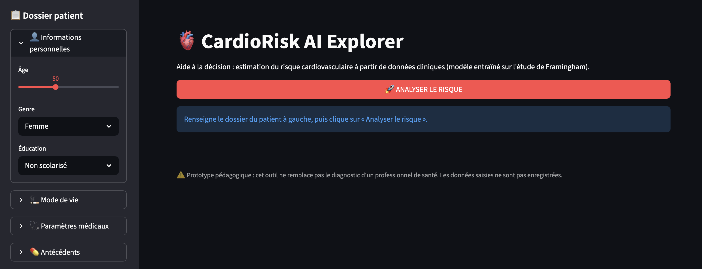
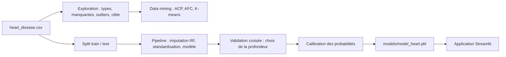

# CardioRisk AI : prédiction du risque cardiovasculaire

Projet **Data Mining & Machine Learning** complet sur le dataset *Heart Disease* (étude de Framingham) : exploration et nettoyage des données, analyses factorielles (ACP, AFC), segmentation des patients (K-means), modèles prédictifs (arbre de décision, réseau de neurones) entraînés dans un **pipeline sans fuite d'information**, puis **application web Streamlit** d'aide à la décision qui estime le risque cardiaque d'un patient à partir de ses données cliniques.

**Stack :** Python · pandas · scikit-learn · prince · SciPy · matplotlib / seaborn · Plotly · Streamlit · joblib

> Démo en ligne : **[lien à ajouter après le déploiement de l'application]**



## Objectif

Aider un professionnel de santé à repérer rapidement les patients à risque cardiaque : à partir de 15 variables (âge, tension, cholestérol, glycémie, tabagisme, antécédents…), le modèle calcule une **probabilité de risque calibrée** et classe le patient en risque `FAIBLE`, `MODÉRÉ` ou `ÉLEVÉ`, avec les variables les plus influentes du modèle.

## Démarche



| Étape | Rôle |
|---|---|
| **Compréhension des données** | Dimensions, types, statistiques descriptives, valeurs manquantes, recherche de valeurs censurées (`<`, `>`), valeurs aberrantes par la méthode IQR (identifiées et conservées), distribution de la variable cible `Heart_ stroke` |
| **Preprocessing** | Encodage du genre, de l'AVC préalable et de la cible, encodage ordinal du niveau d'éducation, imputation des valeurs manquantes par `IterativeImputer` avec `RandomForestRegressor`, standardisation |
| **ACP** | Sur les 8 variables continues : variance expliquée, éboulis, projection des individus (CP1 × CP2), cercle des corrélations, cos² et contributions |
| **AFC** | Tabagisme (`cigsPerDay` discrétisé en 4 classes) croisé avec AVC préalable, hypertension et genre : test du Chi², coordonnées de l'AFC, profils lignes et colonnes |
| **K-means** | Choix de k par la méthode du coude (k = 3), profil moyen de chaque cluster, taux de maladie cardiaque par cluster |
| **Machine Learning** | Arbre de décision (profondeur choisie par validation croisée, `class_weight='balanced'`) et réseau de neurones MLP (64, 32), comparés sur rappel, F1 et AUC ROC |
| **Calibration** | Probabilités de l'arbre calibrées (`CalibratedClassifierCV`, sigmoïde), vérifiées par le score de Brier et une courbe de calibration |
| **Application** | Saisie du dossier patient, probabilité, jauge de risque, conseil général et variables les plus influentes |

### Éviter la fuite d'information

L'imputation et la standardisation font partie du `Pipeline` scikit-learn : elles sont apprises **uniquement sur le jeu d'entraînement** (et refaites dans chaque pli de validation croisée). La profondeur de l'arbre est choisie par `GridSearchCV` sur l'entraînement ; le jeu de test n'est utilisé qu'une fois, pour l'évaluation finale. L'imputation globale du notebook (section III) ne sert qu'à l'exploration non supervisée (ACP, AFC, K-means).

### Variables utilisées

| Type | Variables |
|---|---|
| Continues | `age`, `cigsPerDay`, `totChol`, `sysBP`, `diaBP`, `BMI`, `heartRate`, `glucose` |
| Binaires | `currentSmoker`, `BPMeds`, `prevalentHyp`, `diabetes`, `prevalentStroke`, `Gender` |
| Ordinale | `education` (non scolarisé → post-diplômé) |
| Cible | `Heart_ stroke` (yes / no) |

### Seuils de l'application

| Probabilité de risque | Niveau |
|---|---|
| < 15 % | Risque faible |
| 15 % à 35 % | Risque modéré |
| ≥ 35 % | Risque élevé |

Ces seuils sont indicatifs et appliqués à la probabilité calibrée.

## Résultats

La calibration réduit le score de Brier de l'arbre de 0,217 à 0,122 (plus bas = mieux).

| Modèle | Accuracy (test) | CV 5 plis | Rappel (Yes) | F1 (Yes) | AUC ROC |
|---|---|---|---|---|---|
| Arbre de décision | 64,2 % | 65,3 % | 61,2 % | 34,2 % | 0,660 |
| Réseau de neurones MLP | 85,4 % | 85,0 % | 7,8 % | 13,9 % | 0,685 |


Les valeurs sont affichées par `python train.py` et enregistrées dans `models/metrics.json`. Le même fichier donne le score de Brier de l'arbre avant et après calibration.

Figures générées dans `docs/figures/` (comparaison des modèles, matrices de confusion, choix de la profondeur, importance des variables, calibration).

L'arbre de décision calibré est le modèle déployé dans l'application (score de Brier de 0,217 avant calibration, 0,123 après). Le fichier `model_heart.pkl` ne contient pas l'imputeur Random Forest (trop volumineux) : l'application fournit toujours des valeurs complètes.

## Application

- Formulaire patient dans la barre latérale (informations personnelles, mode de vie, paramètres médicaux, antécédents).
- Bouton **Analyser le risque** : jauge Plotly, résultat par niveau de risque, conseil général.
- Graphique des 8 variables les plus influentes du modèle (importance globale, pas spécifique au patient).

## Structure du dépôt

```
.
├── README.md
├── requirements.txt            # application + entraînement
├── requirements-notebook.txt   # + dépendances du notebook (prince, seaborn, jupyter)
├── train.py                    # pipeline ML : entraînement, évaluation, sauvegarde
├── app.py                      # application Streamlit
├── notebooks/
│   └── projet_Atelier_DM_ML.ipynb   # analyse complète (exploration, ACP, AFC, K-means, ML)
├── data/
│   └── heart_disease.csv       # dataset
├── models/                     # générés par train.py
│   ├── model_heart.pkl         # standardisation + arbre calibré (léger)
│   ├── feature_importances.json
│   └── metrics.json
└── docs/
    ├── app_screenshot.png      # capture de l'application
    └── figures/                # figures du notebook et de train.py
```

## Lancer le projet

**Prérequis :** Python 3.10 ou plus. Aucun Docker n'est nécessaire.

### 1. Cloner le dépôt et installer les dépendances

```bash
git clone https://github.com/Chaki0107/cardiorisk-ai.git
cd cardiorisk-ai
python -m venv .venv
source .venv/bin/activate        # Windows : .venv\Scripts\activate
pip install -r requirements.txt
```

### 2. Entraîner le modèle

Place `heart_disease.csv` dans `data/`, puis :

```bash
python train.py
```

L'imputation Random Forest et la validation croisée prennent quelques minutes. Le script écrit `models/model_heart.pkl`, `models/feature_importances.json`, `models/metrics.json` et les figures dans `docs/figures/`.

### 3. Lancer l'application

```bash
streamlit run app.py
```

L'application s'ouvre sur http://localhost:8501. Si le modèle n'a pas été entraîné, elle affiche un message qui renvoie à l'étape 2.

### 4. Rejouer l'analyse complète (facultatif)

```bash
pip install -r requirements-notebook.txt
jupyter lab notebooks/projet_Atelier_DM_ML.ipynb
```

Exécute les cellules dans l'ordre. La dernière section régénère les fichiers de `models/`.

### Déployer l'application (facultatif)

Sur Streamlit Community Cloud : versionne `models/model_heart.pkl` et `models/feature_importances.json`, et fixe dans `requirements.txt` la version de scikit-learn indiquée dans `models/metrics.json` (un `.pkl` doit être relu avec la version qui l'a créé).

## Données

Le dataset *Heart Disease* est issu de l'étude cardiovasculaire de **Framingham**. La variable cible indique la survenue d'une maladie cardiaque.

| Fichier | Contenu |
|---|---|
| `data/heart_disease.csv` | Données cliniques et comportementales des patients (15 variables explicatives + cible) |

Vérifie la licence et les conditions de redistribution de la source avant de publier le fichier.

## Limites et pistes d'amélioration

- Le réseau de neurones n'est pas optimisé (architecture fixe) et la classe positive étant minoritaire, son rappel est faible : l'accuracy seule est trompeuse, d'où l'usage du rappel, du F1 et de l'AUC ROC.
- La validation croisée qui sert à choisir la profondeur de l'arbre sert aussi à l'estimer : une validation croisée imbriquée donnerait une estimation moins optimiste.
- Seuls deux hyperparamètres de l'arbre sont explorés ; d'autres modèles (régression logistique, Random Forest, gradient boosting) seraient à comparer.
- La calibration est faite sur un seul jeu de données et les seuils 15 % / 35 % de l'application restent indicatifs.
- Le modèle repose sur une cohorte historique et n'a pas été validé sur une population externe (par exemple tunisienne).
- Les valeurs aberrantes sont identifiées mais conservées, et l'imputation du notebook (exploration) porte sur l'ensemble des données.
- Les conseils affichés sont généraux. Cet outil est un **prototype pédagogique** : il ne remplace pas le diagnostic d'un professionnel de santé et n'est pas destiné à un usage clinique.

## Auteure

**Chahnez Naccache** · Master Data Science · [LinkedIn](https://linkedin.com/in/chahnez-naccache) · [Portfolio](https://github.com/Chaki0107/Portfolio)
